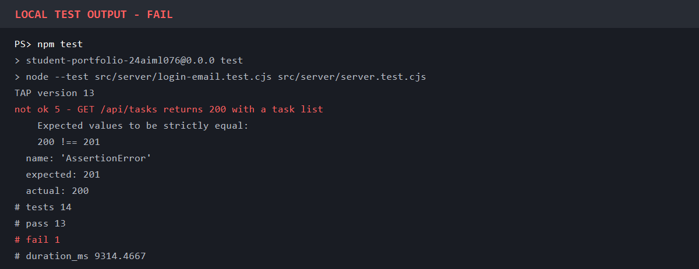
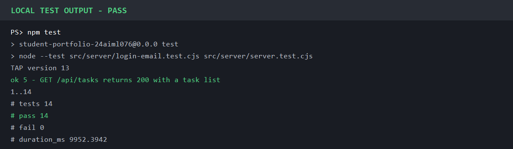
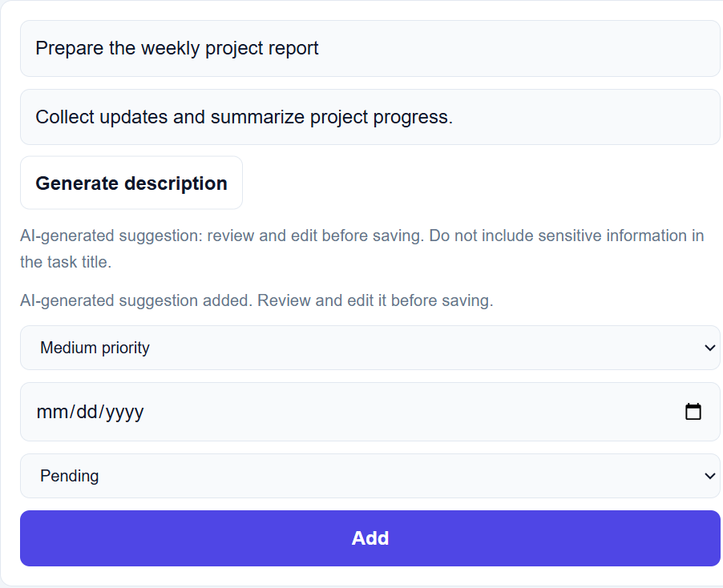
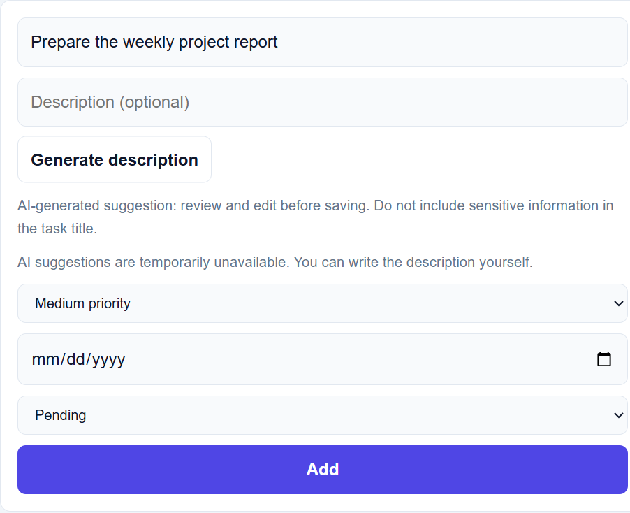
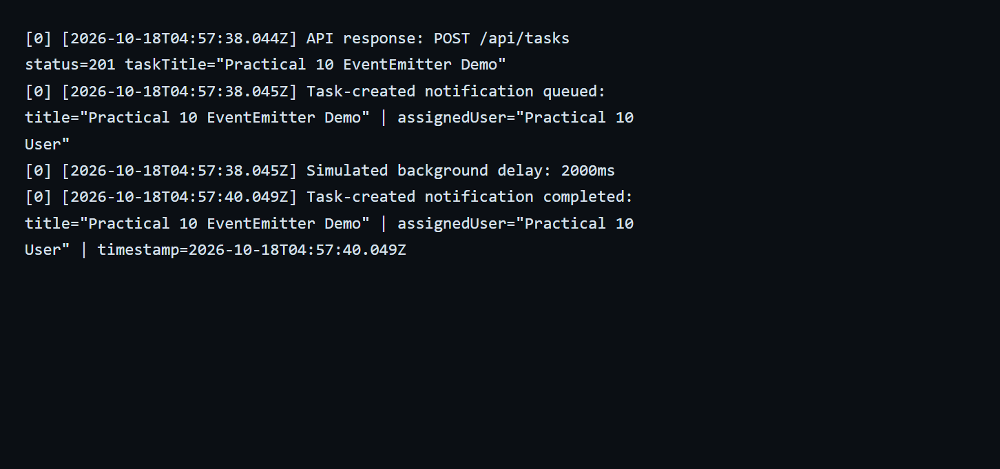
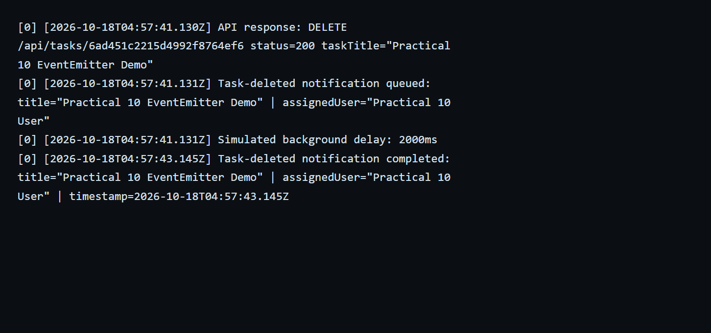

# React Router Portfolio - 24AIML076

A React-based student portfolio website developed for **Practical 2** demonstrating **React Router** and **State Management using useState**.

[](https://github.com/hemangimistry2806/AWD-Practical-2-React-Router-/actions/workflows/ci.yml)

## Technologies Used

* React
* Vite
* React Router DOM
* JavaScript
* CSS

## Components

* NavBar
* Home
* Projects
* Contact
* NotFound
* Header
* About
* Skills
* Footer

## Features

* Client-side routing with React Router
* Navigation without page reload
* Home, Projects, Contact, and 404 pages
* Controlled contact form using `useState`
* Dark/Light mode toggle
* Live input updates
* Component-based architecture
* Reusable React components

## Run Project

```bash
npm install

npm run dev
```

## Practical 11: Run with Docker Compose

Docker Desktop or Docker Engine with the Compose plugin must be installed and running. From the project root, build and start the complete stack with:

```bash
docker compose up --build
```

The image build uses Node 22 because this project's Vite 8 requires Node 20.19 or newer.

Open the frontend at <http://localhost:5173>. The API is available at <http://localhost:5000>, and MongoDB is published on port `27017`. Compose starts MongoDB first, waits for it to become healthy before starting the backend, and then waits for the backend before starting the frontend. Nginx serves the production React build and forwards `/api` requests to the `backend` service.

Stop the stack with `Ctrl+C`; run `docker compose down` to remove its containers. MongoDB data is kept in the named `mongo-data` volume, so it remains available after containers are recreated. To also delete the stored database, run `docker compose down --volumes`.

Optional email settings can be provided through environment variables or a root `.env` file. Set a non-default `JWT_SECRET` for deployments beyond local coursework.

## MongoDB Tasks

The `/tasks` page stores tasks in the local MongoDB database `taskdb`, collection `tasks`.
For local development outside Docker, the default connection is `mongodb://127.0.0.1:27017/taskdb`, so start the MongoDB service before running the project. `npm run dev` starts both the Express API on port `5000` and the React app on port `5173`. In Docker Compose, the backend connects to MongoDB using the service address `mongodb://mongodb:27017/taskdb`.

Deleted task audit entries are appended to `logs/task-audit.txt`.
Authentication creates the MongoDB collections `users` and `activity_logs`. The task API requires a valid signed-in session, and the Activity button shows login, logout, create, update, and delete history.
The Excel button downloads an Excel-compatible CSV file. The PDF button opens the browser print dialog, where you can choose Save as PDF.

To use another MongoDB instance, copy `.env.example` to `.env` and change `MONGO_URI`.

### Email notifications

Email notifications use Nodemailer with React Email templates. Copy `.env.example` to `.env` in the project root, then configure these backend-only variables:

```env
SMTP_HOST=
SMTP_PORT=587
SMTP_SECURE=false
SMTP_USER=
SMTP_PASS=
MAIL_FROM=
MAIL_TO=
MAIL_CC=
MAIL_BCC=
```

`SMTP_HOST`, `SMTP_PORT`, `SMTP_USER`, and `SMTP_PASS` are required to send mail. `SMTP_PORT` must be an integer from 1 to 65535, and `SMTP_SECURE` must be `true` or `false`; use the TLS mode required by your SMTP provider (commonly `true` for implicit TLS on port 465 and `false` for STARTTLS on port 587). `MAIL_FROM` is optional and defaults to `SMTP_USER`. `MAIL_TO`, `MAIL_CC`, and `MAIL_BCC` are optional comma-separated additional recipients for task and logout notifications; login confirmations are sent only to the authenticated account's email address from MongoDB. Keep `.env` private; SMTP credentials are never exposed to the React frontend. If SMTP variables are missing, invalid, or sending fails, the server logs a generic email problem and the authentication/task API operation still succeeds.

Run the project with:

```bash
npm install
npm run dev
```

The API runs on port `5000` and Vite runs on port `5173`. Task-created, task-completed, task-pending transition, login, and logout notifications are sent asynchronously. Pending notifications are sent only when a task changes into `pending`, avoiding duplicate notifications for repeated pending updates. The backend can run without SMTP configuration; email sending is skipped until the required SMTP values are set.

### Administrator activity reports

The `/admin/reports` page and its report APIs require a signed-in user with the `admin` role. New registrations receive the `user` role; promote only the selected trusted account manually from the MongoDB shell:

```javascript
db.users.updateOne(
  { email: "admin@example.com" },
  { $set: { role: "admin" } }
);
```

The activity report filters the existing `activity_logs` collection by its `createdAt` field. Start and end dates are UTC calendar days and both days are included. The report provides paginated records, date-range totals, and a streaming CSV export. Export columns omit email addresses, IP addresses, and browser details. Both the report and CSV endpoint enforce administrator authorization on the server.

After signing in as an administrator, open **Admin reports** from the Tasks page (or navigate to `/admin/reports`). Choose both dates, select **Generate report**, and use **Download CSV** to export the same date range. Run the automated email and report integration tests with:

```bash
npm test
```

## Practical 12: CI Pipeline with GitHub Actions

The workflow at `.github/workflows/ci.yml` runs on every push to `main`. It checks out the repository, sets up Node.js 22, runs the required `npm install` step, and runs `npm test`. A failed install or test makes the job fail; a successful run reports a green check in the repository's **Actions** tab and on the commit. The test suite includes an authenticated `GET /api/tasks` integration test as well as the existing authentication and reports tests.

This practical demonstrates **Continuous Integration (CI)**: changes are integrated and checked automatically. Continuous Deployment (CD) would additionally publish the tested application to an environment, which this workflow does not do.

Automated checks on each push provide fast feedback while a change is small, rather than relying on a developer to remember a manual pre-release test. If a test path or command is incorrect, the test step still fails, but the log reports a missing file/module or invalid command rather than an assertion failure. An assertion failure means the test ran and found an unexpected result.

### Reproducing a failing and passing run

To demonstrate a genuine test failure, temporarily change the expected status in the `GET /api/tasks` test from `200` to `201`, then run `npm test`. The test step exits unsuccessfully and reports the assertion mismatch. Restore the expected status to `200` and rerun `npm test` to get a passing result. Do not leave the broken expectation committed. After pushing this workflow to `main`, use the Actions tab to see the GitHub-hosted run and its job logs.

The images below record the local test-run failure and corrected pass. They are local test output, not screenshots of hosted GitHub Actions runs; those become available after the workflow is pushed.

#### Deliberately broken assertion



#### Corrected test suite



### CI and CD

CI automatically installs dependencies and verifies code changes as they are pushed. CD takes a verified build and delivers it to a staging or production environment. This workflow covers CI only; it does not deploy the application.

## Practical 13: AI Task Description Suggestions

The task editor can request a short description for a task title. The React app sends the title to the authenticated backend endpoint `/api/ai/generate-description`; only the backend calls the OpenAI API. The response is added to the normal editable description field, where the user can review or change it before saving. A loading label is shown during the request, and each signed-in user can request a suggestion once per task title per minute.

To enable live suggestions, add the provider key to the root `.env` file (copy `.env.example` first):

```env
OPENAI_API_KEY=your-openai-api-key
OPENAI_MODEL=gpt-4o-mini
```

Restart the backend after changing environment settings. For Docker Compose, set the same variables in the shell or root `.env` before starting the stack; Compose passes them only to the backend container. The key is not part of the frontend bundle. Without a key, or if the provider fails or times out, the endpoint returns a clear fallback message and users can still write and save task descriptions normally.

The key must remain private and must never be placed in React/Vite variables, browser code, screenshots, or committed files. Only the task title is sent to OpenAI; do not put passwords, personal or sensitive data, confidential work details, or other private information in a title sent for AI processing. AI-generated content may be inaccurate or unsuitable, so review it before use. The application does not require the AI feature to create or edit tasks.

### Practical 13 output evidence

The following UI captures show the suggestion and fallback states using mocked responses. Automated backend tests separately simulate an upstream authentication failure and verify the fallback without spending API credits or exposing a real key.

#### Generated description and rate limit



#### Graceful fallback on provider failure



Run `npm test` to verify the AI endpoint authentication, input validation, generated response, per-task rate limit, and graceful fallback cases.

## Practical 8: Performance Optimization and Lazy Loading

### Objective

Implement route-based code splitting in the existing React Task Management application using `React.lazy()` and `Suspense`, without changing existing functionality, backend APIs, database logic, or UI design.

### What Was Changed

* `Projects` route is lazy-loaded.
* `Contact` route is lazy-loaded.
* `Tasks` route is lazy-loaded as one additional heavier component because it contains authentication flow, API requests, SweetAlert dialogs, filtering, CSV/PDF actions, and activity log rendering.
* The existing `<Routes>` section is wrapped in `<Suspense>`.
* A simple `Loading page...` fallback UI is displayed while a lazy route chunk is loading.

### React.lazy()

`React.lazy()` lets React load a component only when it is needed. Instead of importing all route components in the first JavaScript bundle, the route component is imported dynamically:

```jsx
const Projects = lazy(() => import("./pages/Projects"));
```

This allows Vite to create a separate JavaScript chunk for that route.

### Suspense

`Suspense` shows fallback UI while the lazy-loaded component is being downloaded and prepared:

```jsx
<Suspense fallback={<div className="page-loading">Loading page...</div>}>
  <Routes>
    ...
  </Routes>
</Suspense>
```

### Why Lazy Loading Improves Performance

Lazy loading reduces the amount of JavaScript needed during the first page load. The browser can load the initial page sooner, and route code for pages like Projects, Contact, and Tasks is downloaded only when the user visits those routes. This improves initial load performance and perceived speed, especially on slower networks.

### Initial Bundle vs Lazy-Loaded Chunks

Before lazy loading, route components imported normally in `App.jsx` are included in the initial application bundle. After lazy loading, Vite can generate separate chunk files for lazy routes. The initial bundle should not contain the complete Projects, Contact, or Tasks route code.

### Before/After Metrics

No baseline measurements were already present in the repository, so the table below is provided for manual measurement instead of using fabricated numbers.

| Metric                 | Before | After |
| ---------------------- | -----: | ----: |
| Initial JS transferred |        |       |
| Main bundle size       |        |       |
| Projects chunk         |        |       |
| Contact chunk          |        |       |
| Tasks chunk            |        |       |
| Initial page load time |        |       |
| Projects route load    |        |       |
| Contact route load     |        |       |
| Tasks route load       |        |       |

### How to Get Metrics

1. Run `npm run build` and note the JavaScript files listed in the build output.
2. Open the app in the browser and open DevTools.
3. Go to the Network tab and filter by JS.
4. Reload the home page and record the initial JavaScript transferred.
5. Navigate to `/projects`, `/contact`, and `/tasks`.
6. Record the lazy chunk downloaded for each route.
7. Use DevTools throttling such as Slow 3G to observe the `Loading page...` fallback.

### DevTools Verification

To verify lazy loading:

* Open Browser DevTools.
* Go to Network.
* Enable Disable cache while DevTools is open.
* Load `/` first and confirm that Projects, Contact, and Tasks chunks are not loaded initially.
* Navigate to `/projects` and confirm that the Projects chunk loads.
* Navigate to `/contact` and confirm that the Contact chunk loads.
* Navigate to `/tasks` and confirm that the Tasks chunk loads.
* Refresh each route directly to confirm the existing Vite/React Router setup still serves the app correctly.

### Slow 3G Fallback Testing

In DevTools Network throttling, select Slow 3G and navigate to a lazy route. The fallback text `Loading page...` should appear briefly while the route chunk downloads.

### Additional Lazy-Loaded Component

The additional lazy-loaded component is `Tasks`. It is a suitable candidate because it is larger than the portfolio pages and includes task authentication, API communication, task list rendering, filtering, export actions, and activity log UI. No artificial heavy dependency was added.

### React DevTools Profiler Observation

Actual React DevTools profiling was not performed in this environment, so no runtime profiler result is claimed. By code inspection, `Tasks` has a realistic unnecessary re-render risk: the status tab counts call `tasks.filter(...)` during render for every status tab. When unrelated local state changes, such as typing in the task editor or toggling the input form, these counts are recalculated even though the `tasks` array may not have changed.

A possible optimization is to use `useMemo` to derive status counts from `tasks`, or split the tab list into a memoized child component. Memoization was not added blindly because the assignment asks to identify the issue without changing unrelated behavior unnecessarily.

### Errors or Issues Encountered

No code issue required backend, database, authentication, or API changes. Baseline performance numbers were not available, so placeholders are documented for manual measurement.

### Conclusion

Practical 8 was implemented by adding route-based code splitting with `React.lazy()` and `Suspense`. The Projects, Contact, and Tasks route code can now be loaded separately, reducing initial bundle work while preserving the existing application behavior.

## Screenshots


## Practical 10: EventEmitter Background Processing

Task creation and deletion emit background notifications. Each notification logs the task title and user, waits for the simulated two-second processing delay, and then logs its completion timestamp.

### Task Created Event Output



### Task Deleted Event Output



The create API response was timestamped at `2026-10-18T04:57:38.044Z`, before its notification completed at `2026-10-18T04:57:40.049Z` (2.005 seconds later). The delete API response was timestamped at `2026-10-18T04:57:41.130Z`, before its notification completed at `2026-10-18T04:57:43.145Z` (2.015 seconds later). These captured timestamps demonstrate that the API responds before background notification processing finishes.
